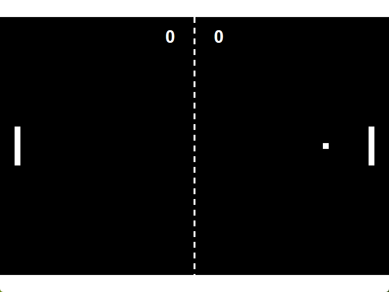

# Pong (With using LLM)

A small Pong game built as an experiment with large language models (LLMs) and vibe coding. The project explores how an AI-assisted, iterative workflow can be used to create a simple game engine and organize a game codebase.



## Features

- Two-player local Pong
- Paddle controls: **W/S** for Player 1 and **Up/Down Arrow** for Player 2
- Ball and paddle collisions, paddle-dependent bounce angles, and increasing ball speed
- Score tracking and a win condition at 10 points
- In-game restart with **R** after a win; exit with **Esc**
- Direct2D graphics and DirectWrite text rendering

## Technology stack

- C++20
- Win32 API
- Direct2D
- DirectWrite
- CMake 3.20 or newer
- Microsoft Visual C++ (MSVC) and the Windows SDK

## Architecture

The code is organized into separate game logic, rendering, and application modules under `src/`. The architecture was inspired by *Game Programming Patterns* by Robert Nystrom.

## LLM

The LLM model used for this experiment is **GPT-6 Luna**, as reported by the project author.

## Platform

This game targets **Windows** and uses Windows-specific APIs and graphics libraries. On other operating systems, run the Windows build through [Wine](https://www.winehq.org/); compatibility is not guaranteed.

## Build

Install CMake 3.20 or newer, Visual Studio with the **Desktop development with C++** workload (MSVC), and a Windows SDK.

From the project root, configure and build with:

```powershell
cmake -S . -B build
cmake --build build --config Release
```

With the Visual Studio generator, the executable is created at `build\Release\Pong.exe`. To build a debug version, use `Debug` instead of `Release`.

## Author's note

Seeing few projects on GitHub, I started thinking about AI as a programming tool. That inspired me to start this experiment. AI works well as a tool if you understand how to create architecture, classes, and functions, and how to debug a program.

In conclusion, I recommend trying to code a program or game manually if you want to become a programmer. Then try vibe coding with any LLM. It helps you understand how to use LLMs effectively in programming, if you want to use them.

P.S.: LLM slightly correct that section